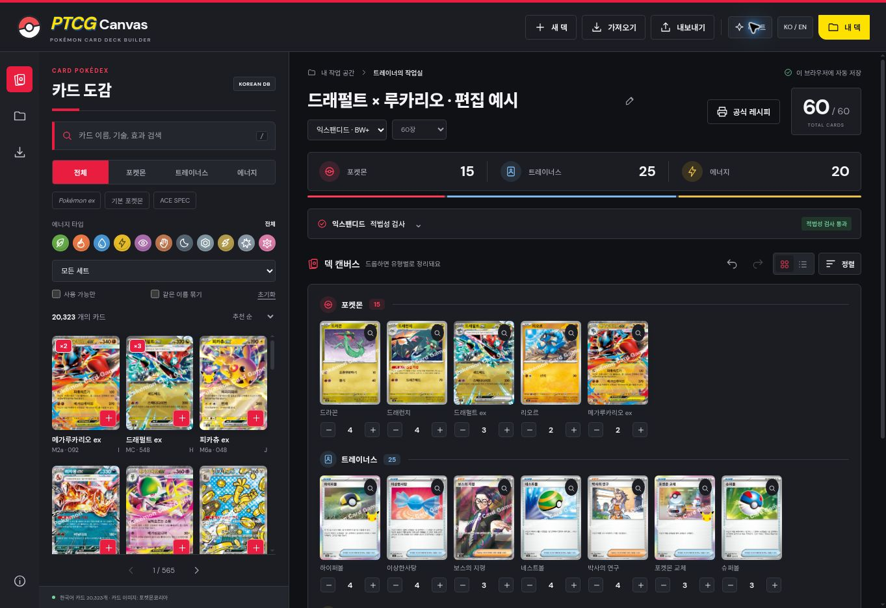

# PTCG Canvas

**GitHub Pages 배포 패키지 v1.2.0** · 먼저 [DEPLOY_GITHUB.md](DEPLOY_GITHUB.md)의 순서대로 업로드하세요.

Commander Canvas의 카드 검색 / 드래그 앤 드롭 편집 흐름을 한국어 실물 포켓몬 카드에 맞춘 정적 웹앱입니다.

## 실행

Node.js 22 이상 (24 권장)에서 추가 패키지 설치 없이 실행합니다.

```bash
npm start
```

http://localhost:5173 에 접속합니다. HTML 파일을 더블클릭하는 file:// 실행은 데이터 로딩 제약 때문에 지원하지 않습니다.

## 기능

- 한국어 카드 20,323개, 264개 세트의 데이터 스냅샷 포함
- 한국어 이름·기술·효과·세트 검색
- 포켓몬/트레이너스/에너지, 아이템/도구/서포트/스타디움 필터
- 타입, 세트, 선택 형식에서 사용 가능한 카드만 보기, 같은 이름 묶기 필터
- 드래그 또는 + 버튼으로 추가, 덱 어디에 놓아도 유형별 자동 분류
- 매수 조절, 덱 카드 → 휴지통으로 1장 삭제, 실행 취소/다시 실행
- 스탠다드 / 익스팬디드 선택과 적법성 검사, 위반 카드별 사유 표시
- 60장 / 40장 연습 목표, 이미지/목록 보기, 이름 순 정렬
- 브라우저 자동 저장, 여러 덱 관리, 복제
- 한국어/영어 인터페이스 전환 (카드 이름·이미지는 한국어 유지)
- 텍스트 / JSON 가져오기 및 내보내기
- 공식 2026 덱 기입용지 XLSX 내보내기, A4 가로 인쇄 / PDF 저장
- 카드 이미지가 포함된 인쇄 / PDF 저장
- 블랙 / 라이트 테마 전환 및 선택 기억
- 카드 상세 및 공식 출처 링크

빈 캔버스의 '예시 덱으로 시작하기'는 60장 편집 예시를 새 덱으로 엽니다. 대회용 추천 덱이 아니며 기존 덱은 보존됩니다.

## 데이터 및 이미지

데이터 출처: https://github.com/type-null/PTCG-database

고정 커밋: `18e0de2feb7a35ebe4296ede0ba6cc768961489b` (저장소 커밋 일자: 2026-09-29)
앱 제작 및 다운로드 확인: 2026-11-10

`public/data/meta.json`에 출처, 커밋과 카드 수가 기록되어 있습니다. 이 저장소의 당시 한국어 데이터를 가공했으며 최신 발매 카드 전체를 보장하지 않습니다. 자료의 오기·누락은 공식 카드 상세와 대조하세요.

카드 이미지는 포켓몬코리아 공식 이미지 주소에 연결하며, 첫 화면과 예시 덱용 52개 이미지는 빠른 로딩을 위한 축소 이미지로 포함됩니다. 그 외 이미지는 인터넷 연결이 필요하고 공식 서버 상태에 영향을 받습니다. 이미지 실패 시 카드명·세트 정보를 표시합니다. 원본 출처 URL을 보존합니다. 데이터 저장소의 MIT 라이선스는 `DATA_LICENSE.txt`에 포함되며 카드 이미지·카드 텍스트·상표 자체에 대한 권리를 부여하지 않습니다. 공개 서비스의 이용 조건은 권리자의 정책을 확인하세요.

업데이트하려면 원본 저장소의 `data_ko`를 내려받은 뒤 Python 3에서 실행합니다.

```bash
python3 scripts/normalize-data.py /absolute/path/to/data_ko
```

원본 디렉터리의 부모에 `source-commit.json`을 아래 형식으로 함께 둡니다. 실제 내려받은 버전의 값을 넣어 주세요.

```json
{"repository":"https://github.com/type-null/PTCG-database","commit":"실제 커밋 SHA","date":"ISO 8601 커밋 일자"}
```

축소 이미지 갱신은 Pillow가 설치된 Python에서 `python3 scripts/fetch-thumbnails.py`를 실행합니다. 앱 실행에는 Python/Pillow가 필요 없습니다. 현재 버전의 정규화는 잘못 합쳐진 분류 표기를 정리하고, ACE 표기를 같은 이름·같은 마크의 재록에 보완합니다.

## 규칙 검사 범위 — 2026-11-11 확인

- **스탠다드:** 한국 공식 H·I·J 마크, 기본 에너지 8종, 한국 구판 재록 허용 목록. 구판 포켓몬은 이름만 같다고 허용하지 않습니다. ACE SPEC 마스터볼과 일반 마스터볼도 구분합니다.
- **익스팬디드:** 일본 공식 엑스트라 BW 이후 규정을 한국어판 카드에 대응합니다. 금지 카드 27종의 판본/효과와 구판 허용 목록, 주박사·플라타느박사·박사의 연구 및 플라드리·보스의 지령의 병용 제한을 확인합니다. 한국 공식 대회 참가 가능을 뜻하지 않습니다.
- 두 형식 모두 정확히 60장, 기본 포켓몬 1장 이상, 같은 이름 4장(기본 에너지 예외), ACE SPEC 1장, 찬란한 포켓몬 1장, 프리즘스타 같은 이름 1장 제한을 확인합니다. 40장 연습 목표를 선택해도 60장 포맷 검사 기준은 바뀌지 않습니다.
- `ex`와 `EX`는 다른 이름이며, 박사의 연구·보스의 지령의 인물 부제는 같은 이름으로 합산합니다.
- 통과 / 부적법 / 확인 필요를 구분합니다. V-UNION 통합 레코드, 마크나 시리즈 정보가 불명확한 카드는 확인 필요로 남깁니다.

규정은 `public/rules.js`의 명시적 스냅샷이며 자동 갱신하지 않습니다. 규정 변경 시 목록과 확인일을 함께 갱신하세요. 실제 카드 상태, 실물 한국어판 여부, 대회별 추가 규정은 검사하지 않습니다.

- 한국 규정: https://pokemoncard.co.kr/card/197
- 일본 엑스트라: https://www.pokemon-card.com/rules/regulation/

## 공식 레시피 내보내기

**공식 레시피**에서 플레이어 이름과 참가 부문을 입력하고 **엑셀(.xlsx) 저장**을 누릅니다. `list(2026).xlsx`의 병합, 스타일, A4 가로 인쇄 영역을 보존하며 포켓몬의 카드명·시리즈 마크·컬렉션 넘버·장수, 트레이너스·에너지 카드명·장수와 합계 수식을 채웁니다. 부문 연령은 첨부한 2026 양식을 따릅니다.

동일 포켓몬의 같은 시리즈·번호는 합치고, 판본이 다르면 행을 분리합니다. 트레이너스와 에너지는 같은 이름을 합칩니다. 포켓몬/트레이너스 28행, 에너지 22행을 넘으면 누락 없이 오류를 표시하고 내보내기를 막습니다. DB의 V-UNION 통합 레코드도 수동 파트 확인을 안내합니다. 부적법·미완성 덱은 표시된 경고를 확인하면서 초안으로 내보낼 수 있습니다.

인쇄 / PDF 버튼은 원본과 같은 3열 배치의 텍스트 양식을 브라우저 인쇄 기능으로 엽니다. A4 가로 및 배율 100%, 브라우저 머리글/바닥글 해제를 권장합니다. 인쇄 미리보기는 브라우저 설정에 따라 달라질 수 있습니다. XLSX는 원본 양식 자체를 유지합니다.

## 덱 가져오기 / 백업

정확한 카드 판본·덱 형식·목표 장수·출력 프로필 보존에는 JSON을 사용하세요. 텍스트는 아래 형식입니다.

```text
4 드라꼰 (SV6 079)
4 하이퍼볼
8 기본 불꽃 에너지
```

세트가 생략되면 같은 이름 중 카탈로그 기본 순서의 판본을 선택하고, 적용 전에 알립니다. 모르는 카드명이나 잘못된 수량은 표시하고 적용을 막습니다. 덱 파일 최대 2MB, 편집 최대 999장입니다.

저장 위치는 현재 브라우저의 LocalStorage입니다. 기기/브라우저 간 자동 동기화는 없으며 사이트 데이터를 지우면 덱도 삭제됩니다. JSON으로 별도 백업하세요.

## GitHub Pages 배포

1. 새 GitHub 저장소를 만들고 이 폴더 **내부 파일 전체**를 루트에 업로드합니다.
2. Settings → Pages → Source를 **GitHub Actions**로 선택합니다.
3. main 브랜치로 푸시하거나 Actions의 Deploy PTCG Canvas to GitHub Pages를 수동 실행합니다.
4. 배포 결과의 주소로 접속합니다.

GitHub용 패키지는 독립 실행에 필요한 소스·데이터·이미지·워크플로를 포함합니다. 배포 워크플로가 페이지 내 다운로드용 소스 ZIP도 자동 생성합니다.

```bash
npm run check
python3 scripts/package-source.py
npm run build
npm run verify:build
```

빌드 결과는 `dist/`에 생성됩니다. 상대 경로를 사용하므로 GitHub Pages의 저장소 하위 경로에서도 실행 가능합니다. 정기 데이터 갱신 작업은 설정하지 않았습니다.

## 검증

20개 Node 테스트는 데이터 무결성, 기존 편집/백업, 형식별 허용·금지 판본, 병용 제한, 이름별 장수, ACE 데이터 보정, XLSX 셀·합계·인쇄 설정 보존과 행 초과 방지를 확인합니다.

브라우저에서 최초 로딩·한국어 검색·드래그 추가·유형별 분류·실행 취소를 확인했습니다. 인쇄/PDF는 브라우저 인쇄 대화상자를 사용합니다. 외부 이미지의 CORS 제한 때문에 이 정적 버전에는 PNG 합성 내보내기가 없습니다.

## 1.1 — 포켓몬 도감 테마

- 몬스터볼 로고, 빨간 도감 사이드바, 노란 액션 버튼과 밝은 캔버스
- 공식 피카츄 아트가 있는 시작 화면
- 11가지 타입 아이콘 버튼: 같은 타입을 다시 누르면 해제
- 모바일 카드 검색/덱 탭과 한국어·영어 UI 유지
- 덱 이름은 입력 중에도 자동 저장하며 기존 저장 덱과 호환

추가 캐릭터 아트의 원본과 권리 정보는 `DATA_LICENSE.txt`에 기록했습니다.

## 1.2 — 공식 사이트 스타일과 대회 준비

- 공식 사이트의 빨강·노랑 포인트, 검정 검색 영역과 각진 메뉴를 참고한 UI
- 블랙/라이트 테마와 설정 저장
- 형식별 적법성 검사, 카드별 위반 사유 및 규정 출처
- 첨부된 공식 2026 양식 기반 XLSX와 인쇄용 레시피
- BW ACE SPEC 누락 및 포켓몬의 잘못된 ACE 분류 보정
- 시리즈 마크와 컬렉션 넘버 분모 복원


